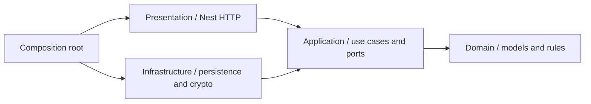

# Архитектура API

Внутренние слои не импортируют NestJS, TypeORM, Node crypto, файловую систему или HTTP DTO. Внедрение зависимостей выполняет только `app/app.module.ts`.

## Ответственность

- **Domain**: товары, пользователи, сессии, заказы, семантические ошибки, допустимые статусы, доставка и возврат остатков.
- **Application**: отдельные `AuthService`, `CatalogService`, `AccountService`, `OrdersService`, `AdminService`. Принимают простые входные модели и абстракции `StoreRepository`/`Security` в конструкторе. Их можно запускать без Nest.
- **Infrastructure**: файловое и PostgreSQL-хранилище, scrypt и токены, чтение окружения и инициализация демонстрационных данных.
- **Presentation**: маршруты, cookie, проверка origin и роли, DTO-валидация, преобразование `AppError` в HTTP-статус.
- **App**: выбирает реализации портов, связывает контроллеры и сценарии, регистрирует guard/filter.

Границы проверяются командой `check:architecture` через AST TypeScript. Unit-тесты запускают сценарии с памятью вместо базы; HTTP-контракты выполняются с двумя реальными адаптерами хранения.

## Атомарность и хранение

`StoreRepository.transaction` — единица работы над снимком коллекций. Цена, остаток, заказ и идемпотентность изменяются вместе. Файловый адаптер сериализует операции и атомарно заменяет JSON. PostgreSQL использует транзакцию и advisory lock, затем записывает только изменившиеся записи.

Сериализация не защищает от устаревшего ввода: для административных изменений дополнительно используется optimistic concurrency через `version`/`expectedVersion`. Проверка версии находится внутри той же транзакции. Все изменения товара, включая продажи и отмены, повышают версию; повтор идемпотентного заказа её не меняет. Метаданные и остатки имеют отдельные операции.

Для масштаба пет-проекта сохранена простая таблица `step_store_records(kind, id, payload jsonb)` с уникальным индексом email. Это осознанный компромисс: операции читают весь снимок, а записи сериализованы. Для большого каталога нужен адаптер с нормализованными таблицами и более узкими блокировками; интерфейс позволяет заменить хранение без переписывания HTTP и UI. API не объявляется готовым к высокой нагрузке.

Формат существующих записей и JSON сохранён, поэтому рефакторинг не требует конвертации данных. Миграция запускается явно и не трогает исторические таблицы. Скрипт импорта старого каталога остаётся одноразовым инструментом миграции, а не отдельным приложением.

## Добавление сценария

1. Опишите модели и правила в domain, входные данные/порт — в application.
2. Реализуйте сценарий с зависимостями через конструктор.
3. Добавьте HTTP DTO/маршрут и явно укажите `Access`.
4. Свяжите зависимости в AppModule и проверьте сценарий на обоих адаптерах.

Клиент поддерживает тот же контракт в `ShopGateway`. Демо-режим — отдельная реализация этого клиентского порта, а не особый режим серверной авторизации.
